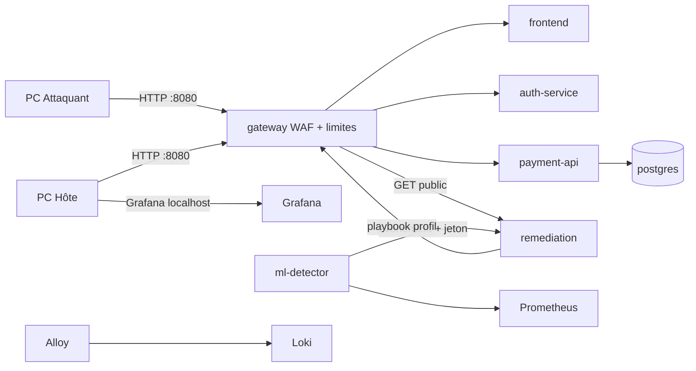

# PROJECT RESILIENCE-ALPHA

Plateforme de paiement **fictive** pour le workshop national Bac+5 EPSI (octobre 2026) : cyber-résilience et **Zero-Touch Recovery**.

Cinq personnes, quatre jours, démonstration vendredi. Données, comptes et trafic sont exclusivement de laboratoire. Aucune donnée financière réelle.

## 1. Présentation

Le consortium conçoit un SI de paiement simulé capable d'encaisser un incident, de le détecter, d'engager une action de remédiation **sans clic opérateur**, puis de prouver qu'une nouvelle transaction fictive fonctionne et que l'intégrité (idempotence) est préservée.

Un redémarrage de conteneur n'est pas une preuve de reprise.

## 2. Objectif et scénario DoS

Scénario retenu : **DoS applicatif par surcharge HTTP contrôlée** depuis un second PC (Locust, garde-fous stricts).

1. Trafic légitime via la passerelle.
2. Charge HTTP sur une route autorisée (`POST /api/payments`).
3. Dégradation mesurable (latence, erreurs, saturation).
4. Prometheus + Loki collectent.
5. Isolation Forest émet un `AnomalyEvent` structuré.
6. Le moteur de remédiation confirme (score, persistance, dégradation ou signal SIEM).
7. Playbook Ansible → profil NGINX `mitigation` (rate limit).
8. Transaction de contrôle via le même point d'entrée.
9. Dashboard (UI + Grafana) : chronologie.

Une anomalie ML **seule** n'exécute aucune commande système. `recommended_action` n'est pas une commande.

## 3. Architecture générale



Détail : [docs/architecture/](docs/architecture/vue-generale.md).

## 4. Stack technique

| Domaine | Choix |
|---|---|
| Métier | Python 3.12, FastAPI, SQLAlchemy, PostgreSQL, Pydantic, JWT RS256 |
| Frontend | React, TypeScript, Vite, Tailwind CSS |
| Infra | Docker Compose, Ansible, NGINX |
| Observabilité | Prometheus, Grafana, Loki, Grafana Alloy |
| IA | pandas, scikit-learn Isolation Forest, joblib ; RAG : Ollama + LangChain (profil séparé) |
| Sécu | ModSecurity / OWASP CRS, SIEM Loki, SOPS, Locust borné |

Aucune dépendance propriétaire payante. Pas d'appel à un LLM cloud pour le RAG.

## 5. Organisation du dépôt

```text
apps/            payment-api, auth-service, frontend
packages/        resilience-contracts (schémas partagés)
ai/              anomaly-detection, rag-assistant
remediation/     moteur de décision + exécuteur whitelisté
infrastructure/  compose, nginx, waf, prometheus, grafana, loki, alloy, ansible
security/        attack-tests, siem, secrets SOPS, policies
tests/           acceptation T01–T12, recette (non validée)
docs/            architecture, API, EBIOS, PCA/PRA, workshop
scripts/         bootstrap, smoke, secrets, nginx -t
```

## 6. Prérequis

**PC Hôte (démo EPSI)** : Windows 10/11, virtualisation, Docker Desktop + WSL2, 16 Go RAM (32 Go confort), clone **dans le FS Linux** (`~/` pas `/mnt/c`).

**PC Attaquant** : Python 3.12, cible = IP privée du hotspot uniquement.

**Développement macOS / Linux** : Docker + Compose v2, Python 3.12, Node 22+, Make, openssl. Compatible tant que la démo finale reste sur le hotspot Windows.

Vérification : `./scripts/check-environment.sh`

## 7–9. Installation, configuration, démarrage

### Démarrage rapide

```bash
cp .env.example .env
./scripts/generate-secrets.sh
docker compose --env-file .env -f infrastructure/docker/compose.yml up -d --build
```

Équivalents Makefile :

```bash
make bootstrap    # .env + secrets
make up           # socle métier + observabilité (sans RAG)
make logs
make smoke
make down
```

Variables : `.env` (non sensible, voir `.env.example`). Secrets : `./secrets/` ignoré par Git. Compte UI : `demo` / `cat secrets/demo_password`.

Ne pas lancer Ollama pour le socle. RAG : `make rag-up` (profil Compose `rag`).

## 10. Accès aux interfaces

| URL | Rôle | Bind défaut |
|---|---|---|
| http://127.0.0.1:8080 | UI + API (passerelle) | `GATEWAY_BIND_ADDR` |
| http://127.0.0.1:3000 | Grafana (mot de passe dans `secrets/grafana_admin_password`) | localhost |
| http://127.0.0.1:8090 | RAG | profil `rag` uniquement |

Démo hotspot : `GATEWAY_BIND_ADDR=<ip mesurée>` (souvent `192.168.137.1`, **à vérifier**). Grafana reste en localhost.

## 11. Tests

```bash
make test              # unitaires + T07–T12 statiques + garde-fous Locust
make test-integration  # T01–T06 live (stack up)
make lint
make smoke
```

T07 utilise des données **synthétiques** : cela valide le code, pas la détection en conditions réelles. La recette Zero-Touch est dans `tests/resilience/` et reste **sautée** jusqu'aux essais datés.

## 12. Chaîne ML / remédiation

1. Features : `request_rate`, `latency_p95`, `error_rate`, `cpu_usage`, `active_requests`.
2. Entraînement : `make ml-train-synthetic` (démo logicielle) ou `make ml-train DATA=...` (Prometheus réel via `make up-dev` + `make ml-collect`).
3. Le joblib n'est **pas** commité. Sans fichier dans `ai/anomaly-detection/models/`, le détecteur ne publie aucun événement.
4. Contrat : `packages/resilience-contracts` / `docs/contracts/`.
5. Politique moteur : allow-list, persistance, corroboration, refus du modèle synthétique par défaut (`REMEDIATION_POLICY_ACCEPT_SYNTHETIC_MODEL=false`).
6. Exécuteur : Ansible (réel) ou `simulated` (journalisé SIMULATION, **pas une preuve**).

Isolation Forest détecte une atypie statistique, pas une attaque à lui seul.

## 13. Test de charge autorisé

Voir [security/attack-tests/README.md](security/attack-tests/README.md). Confirmation interactive `LAB-ONLY`, cible privée explicite, durée et débit plafonnés, pas de lancement auto, pas de distribution. Périmètre = machines du groupe.

## 14. Rôles

P1 Développement · P2 Infrastructure · P3 IA/Data · P4 Cybersécurité · P5 Gouvernance. Détail : [docs/workshop/ROLES.md](docs/workshop/ROLES.md).

## 15. Conventions Git

`main` + branches `pN/sujet`. CI sur push/PR vers `main`. Revue : [CONTRIBUTING.md](CONTRIBUTING.md). Pas de push distant tant que l'équipe n'a pas créé le dépôt GitHub.

## 16. Limites connues

- Pas de modèle ML réel dans le dépôt (détecteur silencieux tant que non entraîné).
- Recette finale attaque→reprise **non validée**.
- Profil NGINX `normal` à calibrer (risque de 429 avant dégradation backend).
- NAT Docker Desktop : une IP client unique possible.
- RAG gourmand, hors chemin critique.
- `create_all` SQLAlchemy : pas encore Alembic.
- WAF CRS par défaut : faux positifs à tester.

## 17. Roadmap quatre jours

| Jour | Attendus sujet | Focus dépôt |
|---|---|---|
| Lundi | Archi + EBIOS | `make up`, hotspot, rôles, risques amorcés |
| Mardi | IaC, ML, Red Team | collecte réelle, Locust calibré, SOPS |
| Mercredi | Intégration | première chaîne observée, dashboard |
| Jeudi | Recette, Clip, gel 17h | livrables `Workshop2026-M2-G<n>-*` |
| Vendredi | Jury | aucune prod |

État détaillé : [PROJECT_STATUS.md](PROJECT_STATUS.md).
