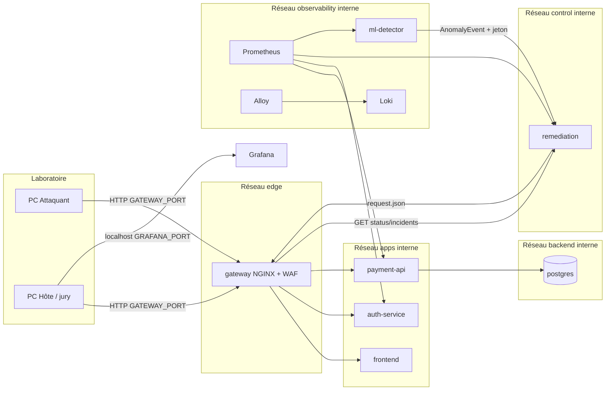
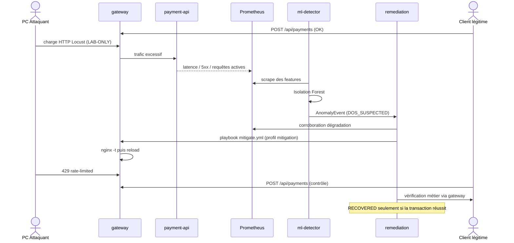

# Diagrammes

## Architecture logique

## Séquence — attaque contrôlée et reprise

## TODO

- [ ] TODO(P2) Ajouter les volumes de contrôle (`gateway-requests` / `gateway-status`) sur un schéma de détail.
- [ ] TODO(P5) Version « grand public » pour le pitch de 5 minutes.
